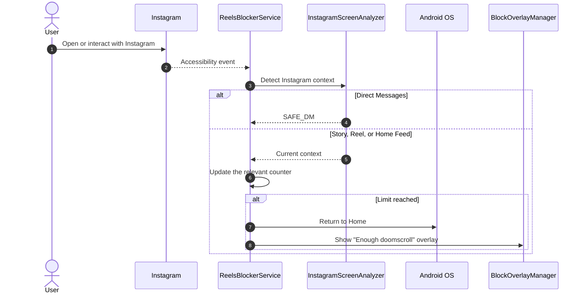

<div align="center">

# Instagram Limiter

**A native Android app that interrupts repetitive Instagram scrolling**

[](https://www.android.com/)
[](https://kotlinlang.org/)
[](https://gradle.org/)

</div>

---

## Overview

Instagram Limiter uses an Android Accessibility Service and an optional overlay permission to monitor Instagram activity. It prompts the user at the start of an Instagram session, counts Reels, Home Feed, and Stories activity, and exits Instagram when a configured limit or cooldown is reached.

The app does not require root access and does not force-stop Instagram. It relies on Instagram's accessibility nodes and resource IDs, so interface changes in Instagram may affect detection.

## Current Behavior

- Detects Direct Messages as a safe area and does not count or block activity there.
- Detects Stories, Reels, and the Home Feed using accessibility view IDs, descriptions, and node selections.
- Shows an **"Are u doomscrolling?"** prompt when the first Instagram event is observed after leaving Instagram or changing apps.
- Pressing **Yes** starts a 60-second cooldown and exits to the Android Home screen.
- Pressing **No** schedules a second prompt 10 seconds later.
- Counts Reels and Home Feed scroll events in one shared counter.
- Counts Story authors separately as the visible Story changes.
- Uses debounced Reel/Feed scroll counting to avoid counting a single gesture repeatedly.
- Enforces a limit of 3 items for scroll activity and 3 Story changes.
- At a limit, exits to the Home screen and shows an **"Enough doomscroll"** overlay with the remaining cooldown.
- Keeps an Instagram session under cooldown by returning to Home and showing the block overlay while the cooldown is active.
- Resets counters when an accessibility event comes from an app other than Instagram.

### Permissions

The app requires both of the following:

- **Accessibility permission** for the `ReelsBlockerService`
- **Display over other apps** permission for the `SYSTEM_ALERT_WINDOW` overlays

The app will not show its countdown overlays if overlay permission is denied.

## Architecture

| Component | Responsibility |
| --- | --- |
| `ReelsBlockerService` | Receives accessibility events, manages session state, counters, prompts, cooldown, and Home-screen exits |
| `InstagramScreenAnalyzer` | Classifies the active Instagram screen and extracts the active Story author |
| `BlockOverlayManager` | Creates and removes intent, block, and cooldown overlays |
| `accessibility_service_config.xml` | Declares the Accessibility Service event types and window-content access |



## Tech Stack

| Category | Technology |
| --- | --- |
| Platform | Native Android, minimum API 26, target API 34 |
| Language | Kotlin 1.9.22 |
| Build system | Gradle 8.5 with Android Gradle Plugin 8.2.2 |
| Android APIs | `AccessibilityService`, `WindowManager`, `SYSTEM_ALERT_WINDOW`, `CountDownTimer` |
| Java target | Java 17 |

## Build and Install

### Prerequisites

- JDK 17
- Android SDK Platform 34
- Android SDK Build Tools 34.0.0
- Android 8.0 (API 26) or newer device
- USB debugging enabled on the device

On Windows, if Gradle cannot find the Android SDK, set `ANDROID_HOME` to:

```text
%LOCALAPPDATA%\Android\Sdk
```

### Build the APK

From the repository directory:

```powershell
.\gradlew.bat assembleDebug
```

The debug APK is written to:

```text
app\build\outputs\apk\debug\app-debug.apk
```

### Install on a connected device

```powershell
adb devices
.\gradlew.bat installDebug
```

## Enable the Service

This project declares an Accessibility Service but no launcher Activity, so open the app's settings through Android rather than an app icon.

1. Go to **Settings > Apps > Instagram Limiter**.
2. Open **Special app access > Display over other apps** and allow the permission.
3. Go to **Settings > Accessibility > Installed apps**.
4. Select **Instagram Limiter** and turn on the service.

On Android 13 or 14, Android may hide or restrict Accessibility Services for sideloaded apps. If the service cannot be enabled, open **App info**, use the top-right menu to allow restricted settings, then enable it again.

The overlay permission can also be granted through ADB:

```powershell
adb shell appops set com.example.instagramlimiter SYSTEM_ALERT_WINDOW allow
```

## Configuration

The primary limits and timing values are constants in [`ReelsBlockerService.kt`](app/src/main/java/com/example/instagramlimiter/ReelsBlockerService.kt):

```kotlin
private val maxItemsLimit = 3
private val scrollDebounceMs = 1100L
private val secondPromptDelayMs = 10_000L
private val cooldownDurationMs = 60_000L
```

After changing these values, rebuild and reinstall:

```powershell
.\gradlew.bat installDebug
```

Instagram-specific view IDs and text indicators are maintained in [`InstagramScreenAnalyzer.kt`](app/src/main/java/com/example/instagramlimiter/InstagramScreenAnalyzer.kt).

## Project Status

The project currently has no automated test suite or configured launcher UI. Validation is primarily manual with a physical device and a connected Instagram account.

Instagram's UI, resource IDs, and accessibility output may change independently of this app, so detection should be verified after Instagram updates.

## License

**Author:** [Costin Ghiujan](https://github.com/coxteen)

**License:** Released under the [MIT License](LICENSE).